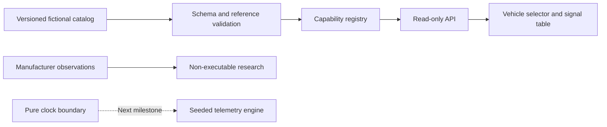

# AutoMate OS

**One Intelligent Platform. Every Vehicle.** AutoMate OS is an automotive simulation laboratory for learning about vehicle systems through fictional profiles and, in future milestones, deterministic scenarios.

## Current status

The Day 2 local foundation is implemented: a React vehicle selector, read-only catalog API, strict data validation, and capability filtering for three fictional profiles and 30 signals. The simulation package currently provides only a pure clock boundary. Readings remain empty; scenario execution, instrument-cluster warning behavior, persistence, and AI investigations are not implemented yet.

The project is educational and simulation-only. It does not connect to or control real vehicles. Manufacturer research is non-executable and separate from the fictional catalog.

## Run locally

Use Node.js 22.12 or newer; Node.js 24 is the CI target. Install from the repository root:

```sh
npm ci
npm run dev
```

On Windows PowerShell, use `npm.cmd` in place of `npm` if execution policy blocks `npm.ps1`. No API key, API credit, database, or `.env` file is required.

- Web: http://127.0.0.1:5173
- API health: http://127.0.0.1:3001/health
- Vehicle list: http://127.0.0.1:3001/catalog/vehicles
- Profile example: http://127.0.0.1:3001/catalog/vehicles/electric-suv-v1

The web server proxies `/api` to the local API; it does not embed catalog data or a secret key in frontend configuration. Web edits reload automatically; restart `npm run dev` after API changes. Stop the launcher with Ctrl+C. If a port is already occupied, stop the existing development server before starting another copy.

`PORT` may be set in the shell before starting the launcher; both API and web proxy use it. `.env.example` documents the name, but local `.env` files are not automatically loaded in this slice. When starting web and API separately, give both the same `PORT` value.

## Development commands

| Command | Purpose |
|---|---|
| `npm run dev` | Run the web and API locally |
| `npm run dev:web` / `npm run dev:api` | Run either service independently |
| `npm run typecheck` | Check strict TypeScript without emitting files |
| `npm test` | Run the reviewed Vitest cases |
| `npm run build` | Typecheck, build web assets, and bundle the portable API |
| `npm run preview` | Serve the web build at port 4173; requires the API running separately |

Tests must receive Review Agent review before execution. See [test cases, review findings, and results](docs/testing/FOUNDATION_TEST_PLAN.md).

## Structure and data flow

```text
apps/web/                React UI and Vite config
apps/api/                Web-standard API and local Node adapter
packages/domain/         Zod schemas and inferred domain/API types
packages/catalog/        Fictional data, validation, and registry
packages/simulation/     Pure simulation-clock boundary
docs/                    Design, ADRs, research, and test plan
evidence/                Actual implementation and validation record
```



## Delivery boundary

The build creates `apps/web/dist/` and `apps/api/dist/index.js`. These are local build outputs, not a complete Sites deployment. The API has a portable fetch handler, but static asset routing, hosting configuration, runtime secrets, access controls, and durable storage must be integrated before publication. No Site has been created or deployed by this change.

When OpenAI investigation is added, its key belongs in server runtime secrets; local key files must stay untracked. All `validRange`, `nominalRange`, sampling periods, and warning thresholds in the starter catalog are fictional assumptions. Profile support does not imply real-car sensor availability or diagnostic access.

Next task: specify and review the seeded sensor-engine and warning-transition tests, then implement deterministic scenario execution and instrument-cluster projection.

## Design

- [Weekend 1 foundation design](docs/FOUNDATION_DESIGN.md)
- [ADR-001: catalog-driven modular monolith](docs/decisions/ADR-001-foundation.md)
- [ADR-002: local runtime and portable API](docs/decisions/ADR-002-local-foundation-runtime.md)
- [Synthetic catalog seed](packages/catalog/data/catalog-seed.json)
- [Manufacturer manual research and coverage gaps](docs/research/MANUFACTURER_MANUAL_REVIEW.md)
- [Structured manual observations](packages/catalog/data/manual-observations.json)
- [Foundation test plan and review](docs/testing/FOUNDATION_TEST_PLAN.md)
- [Implementation evidence](evidence/README.md)
