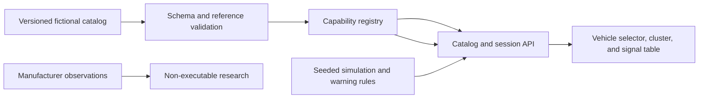

# AutoMate OS

**One Intelligent Platform. Every Vehicle.** AutoMate OS is an automotive simulation laboratory for learning about vehicle systems through fictional profiles and deterministic scenarios.

## Current status

The Day 2 local foundation and first simulation slice are implemented: three fictional profiles, 30 signal definitions, seeded telemetry, scenario-driven EPS/ABS/voltage events, deterministic warning rules, and an instrument cluster. Day 3 adds a PostgreSQL repository for sessions, telemetry snapshots, events, indicator states, and saved reports. In-memory storage remains the default when `DATABASE_URL` is unset. Broader diagnostics and AI investigations remain future work.

The project is educational and simulation-only. It does not connect to or control real vehicles. Manufacturer research is non-executable and separate from the fictional catalog.

## Run locally

Use Node.js 22.12 or newer; Node.js 24 is the CI target. Install from the repository root:

```sh
npm ci
npm run dev
```

On Windows PowerShell, use `npm.cmd` in place of `npm` if execution policy blocks `npm.ps1`. No API key or API credit is required. The API still runs without PostgreSQL using clearly labeled in-memory storage.

- Web: http://127.0.0.1:5173
- API health: http://127.0.0.1:3001/health
- Vehicle list: http://127.0.0.1:3001/catalog/vehicles
- Profile example: http://127.0.0.1:3001/catalog/vehicles/electric-suv-v1

The web server proxies `/api` to the local API; it does not embed catalog data or a secret key in frontend configuration. Web edits reload automatically; restart `npm run dev` after API changes. Stop the launcher with Ctrl+C. If a port is already occupied, stop the existing development server before starting another copy.

`PORT` may be set in the shell before starting the launcher; both API and web proxy use it. The API loads the repository-root `.env` at startup. Set `DATABASE_URL` to enable PostgreSQL; the API applies pending SQL migrations when it starts. If PostgreSQL is already installed and running natively on Windows, use its connection URL and skip the Docker commands. If neither a database nor `DATABASE_URL` is configured, the API uses process-local memory. When starting web and API separately, give both the same `PORT` value.

PowerShell setup for PostgreSQL persistence:

```powershell
if (-not (Test-Path .env)) { Copy-Item .env.example .env }
npm.cmd run db:up
npm.cmd run dev
```

The API starts only after the configured database is reachable and migration succeeds. For a native PostgreSQL installation, ensure `.env` contains its `DATABASE_URL`, then run only `npm.cmd run dev`; `npm.cmd run db:up` is for Docker Compose. To stop a Compose database without deleting its data, run `npm.cmd run db:down`.

## Development commands

| Command | Purpose |
|---|---|
| `npm run dev` | Run the web and API locally |
| `npm run dev:web` / `npm run dev:api` | Run either service independently |
| `npm run db:up` / `npm run db:down` | Start or stop the local PostgreSQL service (Docker Compose required) |
| `npm run typecheck` | Check strict TypeScript without emitting files |
| `npm test` | Run the reviewed Vitest cases |
| `npm run build` | Typecheck, build web assets, and bundle the portable API |
| `npm run preview` | Serve the web build at port 4173; requires the API running separately |

Tests must receive Review Agent review before execution. See [test cases, review findings, and results](docs/testing/FOUNDATION_TEST_PLAN.md).

## Structure and data flow

```text
apps/web/                React UI and Vite config
apps/api/                Web-standard API and local Node adapter
packages/domain/         Zod schemas and inferred domain/API types
packages/catalog/        Fictional data, validation, and registry
packages/simulation/     Seeded telemetry, scenario execution, warnings
docs/                    Design, ADRs, research, and test plan
evidence/                Actual implementation and validation record
```



## Delivery boundary

The build creates `apps/web/dist/` and `apps/api/dist/index.js`. These are local build outputs, not a complete Sites deployment. The API has a portable fetch handler, but static asset routing, hosting configuration, runtime secrets, access controls, and durable storage must be integrated before publication. No Site has been created or deployed by this change.

When OpenAI investigation is added, its key belongs in server runtime secrets; local key files must stay untracked. All `validRange`, `nominalRange`, sampling periods, and warning thresholds in the starter catalog are fictional assumptions. Profile support does not imply real-car sensor availability or diagnostic access.

PostgreSQL stores mutable simulation history only. The fictional vehicle catalog and thresholds remain version-controlled JSON; session rows record the catalog version used. Database schema changes belong in ordered SQL files under `apps/api/db/migrations/`.

## Design

- [Weekend 1 foundation design](docs/FOUNDATION_DESIGN.md)
- [ADR-001: catalog-driven modular monolith](docs/decisions/ADR-001-foundation.md)
- [ADR-002: local runtime and portable API](docs/decisions/ADR-002-local-foundation-runtime.md)
- [ADR-003: deterministic simulation and in-memory reports](docs/decisions/ADR-003-simulation-slice.md)
- [Low-level design and architecture diagrams](docs/LOW_LEVEL_DESIGN.md)
- [ADR-004: PostgreSQL session persistence](docs/decisions/ADR-004-postgresql-persistence.md)
- [Synthetic catalog seed](packages/catalog/data/catalog-seed.json)
- [Manufacturer manual research and coverage gaps](docs/research/MANUFACTURER_MANUAL_REVIEW.md)
- [Structured manual observations](packages/catalog/data/manual-observations.json)
- [Foundation test plan and review](docs/testing/FOUNDATION_TEST_PLAN.md)
- [Implementation evidence](evidence/README.md)
