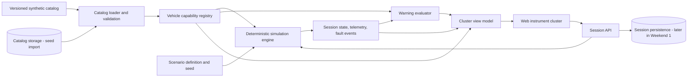

# AutoMate OS foundation design

**Status:** Initial design draft; manufacturer manual research gate added  
**Scope:** Weekend 1 foundation  
**Product boundary:** Synthetic educational simulation; no connection to or control of a real vehicle.

## 1. Goal and boundary

Deliver one functioning virtual vehicle dashboard by building these layers in order:

1. A versioned catalog of fictional vehicle profiles, signal definitions, capability assignments, warning rules, and scenarios.
2. A capability registry that resolves what the selected vehicle can display or simulate.
3. A deterministic virtual sensor engine that advances a seeded session and emits telemetry and fault events.
4. A cluster view model that translates supported signals and active warnings into a vehicle-specific dashboard.
5. A small web/API shell that selects a profile, starts a scenario, advances or resets the simulation, and renders the cluster.

The system must distinguish *supported*, *unsupported*, and *unknown* signals. It must never fill an unsupported signal with a plausible-looking value. Every emitted reading is labeled `synthetic`; later imported or user-provided data will use distinct provenance values.

### Weekend 1 acceptance target

- Select one of three fictional profiles.
- Start its normal seeded scenario and see a cluster configured for that profile.
- Select a supported fault scenario and see deterministic values, events, and warnings update together.
- Reset and replay the same seed to reproduce the same sequence.
- See `UNAVAILABLE` for signals the selected profile does not support.
- See the simulation-only disclaimer and provenance in the UI.

This is a planning target, not a claim that any of it is implemented yet.

## 2. System shape



The arrows show data ownership. The simulator produces structured facts; warning rules evaluate those facts; the cluster renders the resulting view model. The AI investigation layer is downstream of stored session evidence and is outside this first slice.

## 3. Repository and module boundaries

Use a TypeScript modular monolith. Keep domain and simulation packages independent from React, HTTP, database clients, and OpenAI SDKs.

```text
apps/
  web/                 vehicle picker and instrument cluster
  api/                 catalog and simulation-session endpoints
packages/
  domain/              IDs, value types, provenance, validation schemas
  catalog/             seed files, loader, capability resolution
  simulation/          deterministic state transitions and scenario runner
  cluster/             warning evaluation and UI-facing cluster projection
  persistence/         repository interfaces and database adapters
docs/
  FOUNDATION_DESIGN.md
  decisions/ADR-001-foundation.md
```

Dependency rule: `web -> API contracts`; `api -> domain, catalog, simulation, cluster, persistence`; `simulation -> domain`; `cluster -> domain, catalog`; no package imports from `web` or `api` into `simulation`.

## 4. Synthetic catalog and database design

Treat the catalog as normalized domain data. Seed JSON is a reviewable, version-controlled input to the database, not an unrelated second source of truth. Each imported catalog release gets a `catalogVersion`; sessions pin that version so a replay can use the definitions that existed when it was created.

### Core entities

| Entity | Purpose | Key fields |
|---|---|---|
| `VehicleProfile` | Fictional model archetype and cluster layout | `id`, `name`, `segment`, `powertrain`, `catalogVersion`, `clusterConfigId` |
| `Subsystem` | Stable grouping such as powertrain, braking, steering, body, EV energy, ADAS | `id`, `name`, `parentId` |
| `SignalDefinition` | Meaning and constraints for one canonical signal | `id`, `subsystemId`, `valueType`, `unit`, `validRange`, `nominalRange`, `updatePeriodMs` |
| `VehicleSignalCapability` | Profile-specific support and availability | `vehicleProfileId`, `signalId`, `availability`, `reason`, optional configuration |
| `WarningRule` | Deterministic mapping from values/events to an indicator | `id`, `signalId` or `eventType`, `condition`, `severity`, `indicatorId`, `clearCondition` |
| `ScenarioDefinition` | Reproducible normal/fault scenario | `id`, `vehicleProfileId`, `durationTicks`, `seed`, ordered actions |
| `SimulationSession` | One run and replay identity | `id`, `vehicleProfileId`, `catalogVersion`, `scenarioId`, `seed`, `tick`, `status` |
| `TelemetrySample` | Per-tick synthetic value with provenance | `sessionId`, `signalId`, `tick`, `value`, `quality`, `source`, `eventId` |
| `FaultEvent` | Scenario event emitted by the engine | `id`, `sessionId`, `tick`, `eventType`, `affectedSystems`, `causeRef`, `source` |
| `WarningState` | Current indicator state derived from rules | `sessionId`, `indicatorId`, `state`, `severity`, `evidenceRefs` |

Use stable string IDs (for example `engine.rpm`, `electrical.system_voltage`, `steering.eps_status`) in catalog files and database foreign keys. In the seed file, each vehicle's `supportedSignalIds` and `unsupportedSignalIds` are the explicit profile-to-signal assignment; signal definitions contain no second copy of that relationship. A production database stores those assignments as `VehicleSignalCapability` rows. Every signal must be classified for every starter profile; an omitted assignment is `unknown`, not implicitly supported or unsupported. Store scalar telemetry as a typed value (`numberValue`, `booleanValue`, or `enumValue`) rather than an ambiguous string. Enforce one sample per `(sessionId, signalId, tick)` unless a documented sampling model requires more.

### Provenance and quality

- `source`: `synthetic | historical_import | user_provided`.
- Weekend 1 emits only `synthetic` readings and synthetic scenario events.
- `quality`: `valid | stale | invalid | unavailable`.
- `availability`: `supported | unsupported | conditional | unknown`.
- Unsupported signals produce a capability result with a reason and no telemetry sample.
- A stale reading retains its original timestamp/tick; do not relabel it as current.
- Historical imports need dataset/source, license/attribution, import timestamp and mapping record before they are enabled.

### Initial subsystem coverage

Design the catalog to support these groups. Weekend 1 seeds enough signal definitions to make the three starter profiles visibly different; it does not promise that every production car exposes every measurement.

| Group | Examples | Applicability |
|---|---|---|
| Engine and powertrain | RPM, coolant temperature, oil pressure, oil level, engine load, fuel rate, transmission temperature | ICE; transmission details depend on fictional profile |
| Vehicle motion | speed, odometer, trip distance, wheel speeds | All profiles, with clearly defined synthetic source |
| Electrical | 12 V system voltage, charging state, module communication event | All profiles; meaning is profile-configured |
| Brakes and stability | ABS state, wheel-speed sensor status, ESC/ESP event, brake fluid status | Capability-gated; never infer from generic OBD availability |
| Steering | EPS state, steering angle | Capability-gated; EPS means electric power steering |
| Tires and body | tire pressure, seatbelt, door state, ambient temperature | Optional per fictional profile |
| Hybrid and EV energy | state of charge, pack voltage/current/temperature, motor/inverter temperature, regen state, charge state | EV or hybrid profiles only |
| ADAS and comfort | lane-assist status, blind-spot status, suspension state, climate state | Advanced fictional profile only; simulated availability |
| Maintenance and software | service reminder, virtual firmware version, virtual update state | Reminders are computed values; update state is virtual only |

Oil pressure, oil level, oil temperature, and oil-service reminder are separate concepts. EPS and ESP/ESC are separate systems. Indicator state is not automatically a sensor measurement: some indicators are derived from fault events.

## 5. Starter profile and capability matrix

All names and specifications below are invented. They are capability examples, not specifications for a real make or model.

| Capability family | `compact-petrol-v1` | `electric-suv-v1` | `luxury-diesel-v1` |
|---|---|---|---|
| Speed / trip / odometer | Supported | Supported | Supported |
| RPM / engine load / coolant | Supported | Unsupported | Supported |
| Oil pressure / oil level | Both supported | Unsupported | Pressure supported; level unavailable |
| Service reminder | Supported | Supported | Supported |
| Fuel level / fuel rate | Supported | Unsupported | Supported |
| 12 V voltage / module events | Supported | Supported | Supported |
| ABS / ESC status | Supported, simulated | Supported, simulated | Supported, simulated |
| EPS / steering angle | EPS supported; angle unavailable | EPS unsupported in seed | EPS and angle supported, simulated |
| Battery SOC / pack temperature / motor temperature / regen | Unsupported | Supported | Unsupported |
| Front-left tire pressure | Unsupported | Supported | Supported |
| Door / driver seatbelt | Supported | Supported | Supported |
| Blind-spot / ride-height status | Unsupported | Unsupported | Supported, simulated |
| Virtual software state | Not defined in seed | Not defined in seed | Not defined in seed |

The current registry implements supported, unsupported, and unknown assignments. Conditional capability configuration is a future extension, not present in this seed. Do not use a global “car has sensor” assumption. Missing assignments remain unknown until resolved.

## 6. Capability registry contract

Input: `vehicleProfileId`, `signalId`, pinned `catalogVersion`. Output:

```ts
type CapabilityResult = {
  vehicleProfileId: string;
  signalId: string;
  availability: "supported" | "unsupported" | "conditional" | "unknown";
  reason: string;
  definition?: SignalDefinition;
};
```

Resolution order: profile assignment -> conditional configuration -> catalog definition/version check -> result. The seed lists supported and unsupported assignments explicitly; conditional assignments use `availability: "conditional"`, an `enabled` flag and reason. A missing assignment is `unknown`, not implicitly supported. The UI can render unsupported/unknown as unavailable with an explanation and must not call the simulator for that signal.

## 7. Virtual sensor engine

Before implementing signal-to-indicator mappings, complete the evidence review described in [manufacturer manual research](research/MANUFACTURER_MANUAL_REVIEW.md). The starter catalog's numeric ranges, sampling intervals, activation and clearing thresholds are fictional assumptions, not OEM calibrations. Knowledge-source provenance is separate from telemetry provenance. Manufacturer observations remain in a separate non-executable research catalog until scope and behavior are reviewed.

Rules need operating-state conditions (ignition-on, cranking, engine-running, EV-ready, charging), self-check behavior, steady/flashing presentation, sounds/messages, and documented or explicitly fictional time/clearing conditions. A charging-system warning must not be inferred universally from one voltage cutoff. Display availability, simulation support, and diagnostic access are independent capability dimensions.

### State and transition

Keep the engine pure and deterministic. Its transition is conceptually:

```text
nextState = step(previousState, scenarioActionsAtTick, vehicleCapabilities, seed, tickDuration)
```

The seed initializes a small documented PRNG only where bounded variation is useful. Prefer deterministic equations and scenario actions for core values. The engine must not call a network service, database, clock, or LLM. An explicit `tick` is the only time source.

Session state contains the pinned profile/catalog/scenario IDs, seed, current tick, supported signal values, quality/provenance, active fault events, and warning state. Scenario actions alter state at specified ticks (for example, gradual undervoltage followed by simulated module communication warnings); they do not arbitrarily toggle unrelated dashboard lights. Cross-system dependencies are explicit scenario rules, fictional, and not real-vehicle causal claims.

### First scenario set

1. `normal-idle`: profile-specific normal baseline.
2. `engine-overheat`: compact petrol and luxury diesel; coolant rises by scheduled ticks and the temperature indicator follows a documented threshold.
3. `low-oil-pressure`: ICE only; pressure warning event is distinct from oil level and service reminder.
4. `low-12v-voltage`: all profiles; a fictional voltage event may produce configured module warnings without declaring the root cause of each system fault.
5. `ev-battery-temperature`: EV only; pack temperature warning follows scenario-defined thresholds.
6. `abs-wheel-sensor`: profiles configured with ABS; the ABS event is separate from engine warnings and stability state.

Each scenario declares its supported profiles, actions/tick, expected event IDs, expected indicator states, and end condition. Invalid profile/scenario combinations return a typed unsupported result.

### Replay contract

Same catalog version + profile + scenario + seed + initial state + ordered controls => identical tick states and event IDs. Pause/resume preserves state; reset creates a fresh session with the original replay inputs. Persist scenario actions and controls so replay does not depend on browser timing.

## 8. Warning evaluator and cluster projection

Do not let React components define warning thresholds. A pure warning evaluator consumes capability results, current signal values, and events, then emits `WarningState` values with evidence references. A separate cluster projection maps vehicle-specific layout slots to:

- gauge/number cards: speed, RPM (ICE only), SOC (EV only), temperature, voltage;
- warning indicators: active/clear/unavailable plus severity and evidence reference;
- signal rows: current value, unit, freshness, source label and quality;
- session controls: start, pause, advance, reset, scenario and seed.

When a signal is unsupported, the projection returns a visible `unavailable` state and reason. Warning copy must say “simulated warning” and avoid phrases that imply measured real vehicle behavior or a confirmed repair diagnosis.

## 9. API, UI, and persistence responsibilities

### Initial API boundary

- `GET /health`: service health only.
- `GET /catalog/vehicles`: list fictional profiles and summary capabilities.
- `GET /catalog/vehicles/{id}`: profile, cluster configuration, capability results.
- `POST /sessions`: create a session from a validated profile/scenario/seed.
- `POST /sessions/{id}/advance`: advance a bounded number of explicit ticks.
- `POST /sessions/{id}/reset`: reset from stored replay inputs.
- `GET /sessions/{id}`: current state, telemetry window, events and warning states.

Validate requests and responses at the API boundary. Bound advance ticks. Return typed errors for unknown profile, unsupported scenario, invalid seed, or missing session. The browser renders only API data and does not reimplement simulator rules.

For the initial local foundation, load the versioned seed catalog and persist session records using PostgreSQL behind a repository interface. If database setup delays the first dashboard, use a clearly marked in-memory adapter with the same interface for the first local slice and record that as a temporary implementation decision; do not describe it as durable storage.

### Initial dashboard

One responsive cockpit page: profile selector, `SIMULATED / EDUCATIONAL / NOT A REAL VEHICLE DIAGNOSTIC` banner, key gauges, subsystem warning strip, capability-aware signal table, scenario selector, seed, advance/pause/reset controls, provenance/freshness labels, and a small event timeline. No 3D model, login, real car connector, or AI calls are needed to meet this first goal.

## 10. Build sequence and design gates

| Step | Design/build unit | Gate |
|---|---|---|
| 1 | Repo skeleton, workspace scripts, architecture ADR | Every package has a clear boundary; `GET /health` is documented |
| 2 | Domain types and catalog schemas | Invalid units/ranges/IDs fail catalog load; seed data is reviewed |
| 3 | Three fictional profiles and capability registry | Unsupported measurements cannot be emitted |
| 4 | Pure seeded sensor engine and initial scenarios | Same replay inputs reproduce identical states/events |
| 5 | Warning evaluator and cluster projection | Indicators derive from explicit rules and cite evidence IDs |
| 6 | API and instrument cluster page | Selecting and replaying a scenario updates the whole dashboard |
| 7 | Persistence adapter and session history | A session can be reopened with pinned catalog/scenario inputs |

Before moving on to the AI investigator, the engine, catalog, cluster projection and persistence contracts must be stable. Before importing historical datasets, add provenance and license records.

## 11. Out of scope for this foundation

Real OBD/CAN/ECU or OEM data access, firmware writes, actual OTA, vehicle controls, certified diagnostic or repair guidance, Android/Android Auto integration, production-car compatibility claims, 3D assets, and LLM-generated telemetry. Hybrid, pickup, commercial van, and additional segment profiles can be added later by catalog data and tests without changing the engine contract.

## 12. AI-assisted software lifecycle

Use AI as an engineering assistant across a controlled delivery cycle:

1. **Discover:** inspect repository reality and restate one scoped outcome.
2. **Design:** update this architecture, schemas, and an ADR before broad implementation.
3. **Build:** implement one package boundary at a time; keep sensor values and warning logic deterministic code/data.
4. **Verify:** run only the checks agreed for that task, retain actual outputs, and fix observed failures.
5. **Review:** inspect data provenance, capability gaps, permissions, safety wording, and replay determinism.
6. **Record:** update the evidence log with the actual prompt/task, model/effort when available, files, commands, outcomes, and unresolved risks.

AI may help draft schemas, code, documentation, and explanations. It must not fabricate vehicle specifications, telemetry, test outcomes, judge feedback, or sources. A future OpenAI investigator may explain stored synthetic evidence, but the simulator remains authoritative for generated values and event timing.
