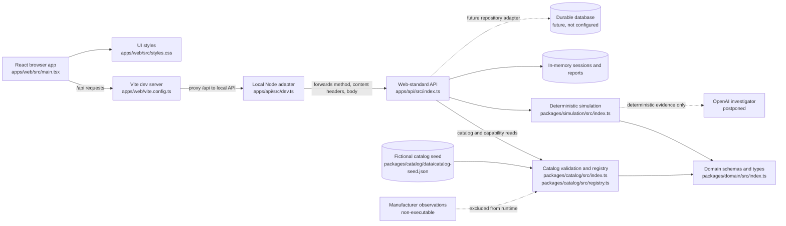
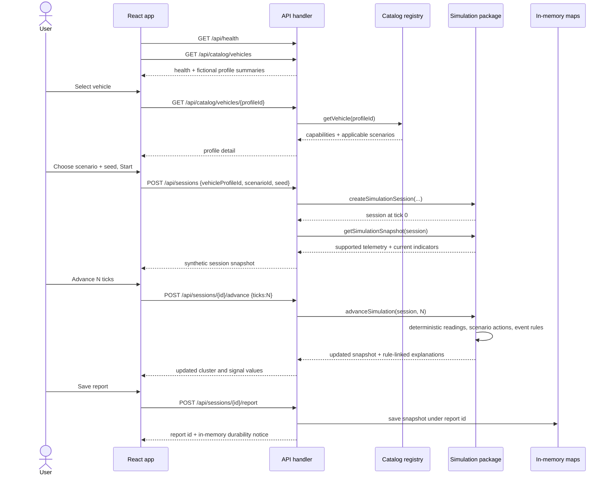
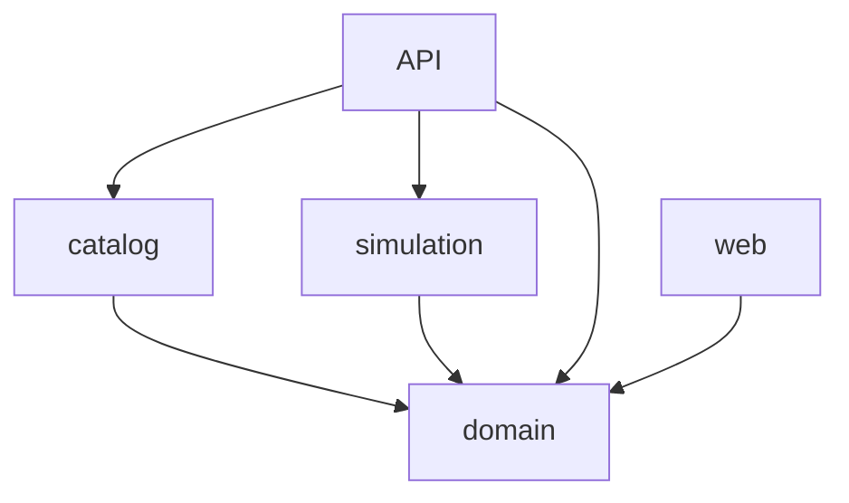

# AutoMate OS low-level design

Status: describes the implementation in this repository as of 2026-11-26. Solid paths below are implemented. Dashed paths are future work.

## 1. Architecture at a glance

**Runtime boundaries:** Domain schemas have no app dependencies. Catalog and simulation depend on domain types, but not on React, HTTP, a database, or an AI SDK. The API composes catalog and simulation and exposes Web-standard `Request`/`Response` handlers. The Node adapter is only a local transport wrapper. Reports currently live in a `Map` owned by the API handler; the dashed database path is not implemented.

## 2. Main interaction: select, simulate, fault, explain, save

### Tick and warning behavior

1. The API creates a session only when the profile and scenario exist, the scenario includes the profile, and the seed is a safe nonnegative 32-bit integer.
2. The simulator creates values only for `profile.supportedSignalIds`. Number signals start from fictional demonstration baselines with deterministic seed/tick/signal jitter; enum and boolean signals use deterministic generated values.
3. When a session advances, the simulator applies scenario actions up to the new tick. `set_signal` sets a value, `ramp_signal` interpolates a numeric value, and `emit_event` adds a scenario event.
4. Warning rules from the catalog are evaluated against values and events. Numeric rules use activation and clear thresholds; event rules activate when their configured event has occurred. The explanation includes the rule or event identifier.
5. The API returns the snapshot. The browser renders these values and states; it does not contain threshold logic.

**Current implementation detail:** `getSimulationSnapshot` derives the readings again from seed and tick, while recording scenario events and prior numeric indicator states on the mutable session object. The API owns session lifetime and calls the simulator synchronously; it does not run a wall-clock loop. Explicit user advances make replay timing independent of browser timers.

## 3. HTTP surface

| Method and path | Purpose | Current behavior |
|---|---|---|
| `GET /health` or `/api/health` | Service readiness | Returns service name, catalog version, and simulation readiness. |
| `GET /catalog/vehicles` | Vehicle chooser | Returns fictional profile summaries and capability counts. |
| `GET /catalog/vehicles/{id}` | Vehicle setup | Returns capabilities, subsystem metadata, and scenarios applicable to that profile. No telemetry is returned here. |
| `POST /sessions` | Start session | Accepts `vehicleProfileId`, `scenarioId`, and `seed`; returns the initial snapshot. |
| `GET /sessions/{id}` | Read current session | Returns the latest derived snapshot for a process-local session. |
| `POST /sessions/{id}/advance` | Advance explicitly | Accepts `ticks` from 1 to 1000, bounded by the scenario duration. |
| `POST /sessions/{id}/report` | Save report | Stores the current snapshot in process memory and marks the session saved. |
| `GET /reports` | List reports | Lists reports in this API process only. A restart clears them. |

Errors use JSON `{ error: { code, message } }` responses. Catalog routes are read-only; session creation, advancing, and report saving are the supported POST operations.

## 4. File-by-file low-level responsibilities

### Domain, catalog, and simulation packages

| File | Responsibility and call relationship |
|---|---|
| `packages/domain/src/index.ts` | Zod schemas and inferred TypeScript types for signals, profiles, warning rules, scenario actions, catalog data, capabilities, catalog responses, and health. It is the shared vocabulary; it contains no runtime behavior. |
| `packages/catalog/data/catalog-seed.json` | Versioned fictional source of truth for subsystem IDs, 30 signals, three profiles, rules, and scenarios. Extend this file to add fictional catalog entries; maintain capability, profile, rule, scenario, and event references consistently. |
| `packages/catalog/data/manual-observations.json` | Non-executable research notes. Runtime catalog code deliberately does not import this file. |
| `packages/catalog/src/registry.ts` | `parseCatalog` checks schemas, duplicate IDs, references, supported signal assignments, scenario ordering/ranges, and event applicability. `createRegistry` exposes detached vehicle summaries, capabilities, and profile-specific scenario lists. |
| `packages/catalog/src/index.ts` | Loads the JSON seed, exports the validated catalog and the default registry, and re-exports registry construction helpers. The API imports these defaults. |
| `packages/catalog/src/registry.test.ts` | Catalog integrity, reference validation, capability availability, detached response behavior, and scenario applicability regression cases. |
| `packages/simulation/src/index.ts` | Pure generation/rule module plus mutable session state passed by the API. `createSimulationSession` validates inputs; `advanceSimulation` applies bounded explicit tick changes; `getSimulationSnapshot` creates supported readings, applies due actions, records events, evaluates warning rules, and returns a serializable snapshot. The original `createClock`/`advanceClock` remain as clock primitives. |
| `packages/simulation/src/index.test.ts` | Clock safety and simulation cases for deterministic replay, capability gating, EPS and voltage scenarios, validation, bounds, and hysteresis clearing. |

### API and web application

| File | Responsibility and call relationship |
|---|---|
| `apps/api/src/index.ts` | Composition root. Imports the default registry/catalog and simulator. `createApi` closes over the session and report maps, routes requests, translates inputs to simulator calls, and returns JSON with no-store/security headers. `handleRequest` is the default local handler and portable fetch export. |
| `apps/api/src/dev.ts` | Node-only HTTP adapter bound to loopback. Converts Node incoming requests to Web `Request`, invokes the API handler, then writes the Web `Response`. Keep Node APIs out of domain/catalog/simulation packages. |
| `apps/api/src/index.test.ts` | Contract cases for health/catalog routes, capability truthfulness, request errors, session lifecycle, profile filtering, report history, and invalid advances. |
| `apps/web/src/main.tsx` | React application. Loads health, vehicle summaries, and selected vehicle details; allows profile/scenario/seed selection; sends session commands; and renders current readings, indicators, explanation text, events, and report-save status. UI requests API data rather than implementing warning thresholds. |
| `apps/web/src/styles.css` | Responsive layout, forms, tables, cluster cards, warning states, and small-screen behavior. Contains presentation only. |
| `apps/web/index.html` | Vite document shell and React mount point. |
| `apps/web/vite.config.ts` | Vite React config and `/api` proxy to the local API for development/preview. |

### Workspace, scripts, and design records

| File | Responsibility |
|---|---|
| `package.json` | npm workspace root and commands for development, typecheck, test, build, and preview. |
| `package-lock.json` | Locked dependency graph for reproducible npm installation. |
| `packages/*/package.json`, `apps/*/package.json` | Workspace package names, exports, build/dev scripts, and internal dependencies. API depends on catalog, domain, and simulation; simulation depends only on domain. |
| `tsconfig.json` | Strict TypeScript configuration shared by workspace packages. |
| `vitest.config.ts` | Vitest setup and workspace test discovery. |
| `scripts/dev.mjs` | Starts the API and Vite as child processes and stops both together. |
| `docs/decisions/ADR-001-foundation.md` | Original catalog-driven modular architecture decision. |
| `docs/decisions/ADR-002-local-foundation-runtime.md` | Web-standard API and local runtime choices. |
| `docs/decisions/ADR-003-simulation-slice.md` | Deterministic local simulation and intentionally temporary in-memory report decision. |
| `docs/FOUNDATION_DESIGN.md` | Broader product boundary, simulation principles, warning and replay design goals, and future scope. |
| `docs/testing/FOUNDATION_TEST_PLAN.md` | Test cases, review gate, review approvals, manual browser cases, and observed execution results. |
| `docs/research/MANUFACTURER_MANUAL_REVIEW.md` | Manufacturer source coverage and evidence limitations; not an executable rules source. |
| `evidence/README.md` | Dated record of implementation scope, checks, and limitations. |
| `README.md`, `AGENTS.md` | User-facing project summary/run instructions and repository-specific contributor/testing guidance. |
| `.env.example`, `.gitignore` | Environment variable example and exclusions for secrets/build outputs/local files. |

## 5. Dependencies and change rules

- Put new shared request/response structures in `packages/domain/src/index.ts`.
- Put fictional sensor metadata, capabilities, thresholds, and scenario actions in `catalog-seed.json`; keep runtime validation in `registry.ts`.
- Keep value generation, action execution, and warning transitions in `packages/simulation`; do not copy this logic into React or HTTP routes.
- Keep URL parsing, request validation, status codes, and process-local storage in the API composition boundary.
- Keep display labels and UI state in the web app. The web client may format simulator output, but must not invent readings or decide warnings.
- Preserve the synthetic/fictional notice and do not mix manufacturer observations into executable rules.

## 6. Deliberate gaps and next design steps

- **Persistence:** sessions and reports use maps in `apps/api/src/index.ts`; they disappear on process restart and are not shared across server instances. Before adding a database, define a repository interface and decide retention, report version pinning, and deployment storage.
- **Cluster projection:** the current cluster is rendered directly in `main.tsx` from snapshots and a short reading list. A future projection module should map profile-specific slots and unsupported capability states without moving warning logic into UI code.
- **Coverage:** current catalog contains 7 scenarios; broader diagnostics and the planned 10+ cases remain unfinished.
- **Browser automation:** Playwright is not installed. New simulation UI flows have manual acceptance cases but have not yet been observed in a browser.
- **AI:** no OpenAI client is present or required. If added later, it should consume saved synthetic evidence and never generate authoritative telemetry or rule states.
- **Vehicle interaction:** no real OBD/CAN/ECU connection, vehicle control, OEM calibration, certified diagnostic, or repair recommendation exists in this architecture.
